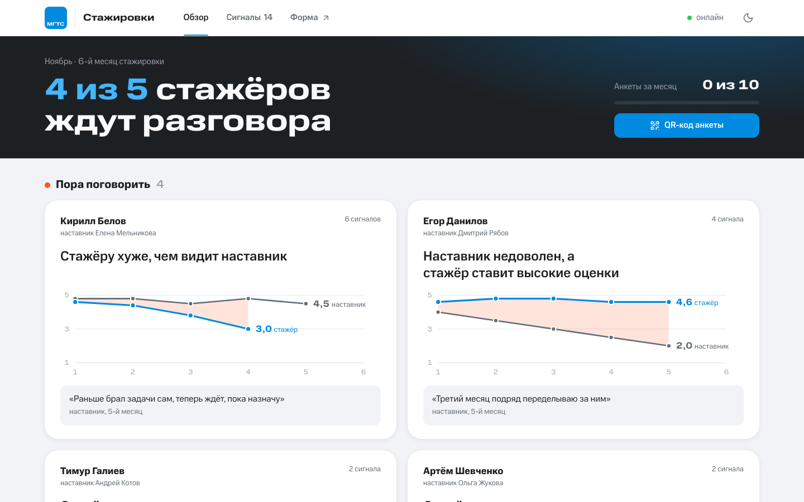
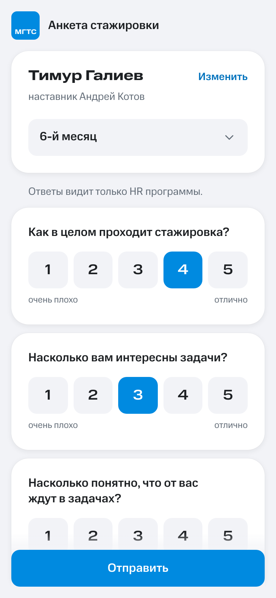

# Дашборд мониторинга стажировок

Решение для кейс-чемпионата МГТС «Код города», направление «ИИ и автоматизация бизнес-процессов».

Стажёр и наставник каждый месяц заполняют анкету: оценки и комментарии. Сейчас HR сопоставляет их вручную. Дашборд собирает ответы в одном месте, показывает динамику и расхождения по каждой паре и подсказывает, с кем пора поговорить и почему.

Статус: рабочий прототип, запускается локально командой `make up`.

## Скриншоты

Обзор: пары по месяцам. В клетке оценка стажёра синим и наставника серым, заливка показывает статус месяца, справа главный сигнал пары.



Пришла анкета Ильи Морозова за 6-й месяц. Дашборд обновился без перезагрузки: пара перешла из «Всё ровно» в «Пора поговорить», у клетки метка «новое», справа внизу уведомление.


Форма анкеты на телефоне.



Карточка пары, экран сигналов и обзор в тёмной теме лежат в `docs/screens/`.

## Как это работает

```
Excel с историей ──► импорт ──┐
                              ├──► база ──► расчёт сигналов ──► дашборд для HR
форма (новый ответ) ──► API ──┘
```

1. История за прошлые месяцы загружается из двух таблиц Excel: ответы стажёров и ответы наставников.
2. Новые ответы приходят из формы, которая повторяет анкету. Ответ по API попадает в сервис, и дашборд обновляется сам.
3. По каждой паре «стажёр — наставник» сервис считает сигналы.
4. HR видит сигналы с объяснением и отмечает, подтвердился сигнал или нет.

## Сигналы

| Сигнал | Как считается | Почему важен |
|---|---|---|
| Спад | оценка падает два месяца подряд или резко за месяц | тренд говорит больше, чем уровень |
| Разрыв | разница между средней оценкой стажёра и наставника за месяц и её рост | одна сторона не видит проблему, которую видит другая |
| Текст против оценки | оценка высокая, а в комментарии жалоба | оценку ставят из вежливости, в тексте пишут правду |
| Молчание | пустой или резко укоротившийся комментарий, пропуск анкеты, одинаковые оценки | кто перестал писать, часто уже не ждёт, что его услышат |
| Наставник недоволен, стажёр доволен | обратный разрыв | стажёр рискует не попасть в штат и не знает об этом |

Правила:

- Оценки считаются формулами. Комментарии разбирает словарь или модель, оценки они не трогают.
- К каждому выводу о тексте прикладывается цитата, и сервис проверяет, что она дословно есть в ответе. Вывод без подтверждённой цитаты отбрасывается.
- ИИ ничего не решает. Он показывает HR, на что посмотреть, решение принимает человек.

## Экраны

Интерфейс один, для HR.

- **Обзор.** Четыре итога (сколько пар в каждом статусе и сколько анкет пришло за месяц) и таблица «пара × месяц»: в клетке оценки стажёра и наставника, заливка показывает статус, справа главный сигнал.
- **Карточка пары.** График с двумя линиями (оценки стажёра и наставника), комментарии с подсвеченными цитатами, сигналы с объяснением и рекомендованным действием.
- **Сигналы.** Строка на сигнал, по клику раскрываются объяснение, цитата, действие и отметка «Подтвердилось» или «Ложная тревога».
- **Форма.** `/form` для стажёра и наставника, с телефона, без меню дашборда.

## Стек

- **Бэкенд:** Python, FastAPI, SQLite, openpyxl для чтения Excel.
- **Фронтенд:** React, Vite, recharts. Стиль МГТС как на studchamp.mgts.ru: синий #008AE0, шрифты MTS Wide, Compact и Text, всё на CSS-переменных.
- **Форма:** своя страница `/form` шлёт анкету в `POST /api/ingest`. Яндекс Формы шлют вебхук в `POST /api/ingest/yandex`, ответы Google Форм бэкенд сам забирает из опубликованной таблицы (`POST /api/sync/gsheet`).
- **Разбор текста:** по умолчанию словарь (`LLM_PROVIDER=rules`), работает без сети. С `LLM_PROVIDER=openai` комментарии читает модель через OpenAI-совместимый клиент: Qwen локально через Ollama, чтобы данные не уходили наружу, или внешний API.
- **Запуск:** Docker Compose, локально.

## Данные

Все ответы приводятся к одной схеме:

| Поле | Что в нём |
|---|---|
| `pair_id` | пара «стажёр — наставник» |
| `role` | `intern` или `mentor` |
| `month` | номер месяца программы |
| `question_id` | вопрос анкеты |
| `score` | оценка |
| `text` | комментарий |

Под конкретные таблицы меняется только словарь соответствия колонок.

## Проверка качества

Тестовый набор: несколько пар на шесть месяцев с заложенными сценариями (выгорание, конфликт с наставником, нехватка задач) и благополучные пары для контроля. Проверяем, что сервис находит заложенное, не поднимает тревогу на благополучных и что все цитаты есть в исходных ответах.

## Запуск

Для запуска в Docker на Ubuntu нужны [Docker Engine и плагин Compose](https://docs.docker.com/engine/install/ubuntu/), Git, Make и curl. Для `make dev` нужны uv, Node 24 и pnpm (`corepack enable`). Для ссылки на телефон нужен cloudflared.

```sh
make up       # всё в Docker: дашборд http://localhost:8080, форма http://localhost:8080/form
make down     # остановить Docker
make up-ai    # запустить дашборд с локальной моделью Qwen через Ollama
make down-ai  # остановить стек с Ollama
make dev      # без Docker: бэкенд :8000, дашборд http://localhost:5173, Ctrl+C гасит оба
make tunnel   # публичная ссылка только на форму (:8081), на телефоне открыть её с /form
make demo     # отправить анкету S-01 за 6-й месяц; для Docker make demo API=http://localhost:8080
```

### Локальный анализ комментариев с Qwen

`make up-ai` запускает Ollama, автоматически скачивает `qwen2.5:7b-instruct` и проверяет, что модель отвечает, прежде чем запустить бэкенд. Модель работает на CPU и анализирует комментарии к анкетам. Дашборд открывается на [localhost:8080](http://localhost:8080/). Порт Ollama доступен внутри сети Compose.

Для первого запуска нужны интернет и свободное место под образы и веса модели (около 4,7 ГБ только для Qwen). Команда ждёт первого расчёта аналитики, пока модель разбирает демоданные. База, результаты анализа и веса сохраняются в Docker-томах после `make down-ai`. Чтобы переключиться на словарь по умолчанию, выполните `make down-ai`, затем `make up`.

Чтобы проверить модель, отправьте в тестовую базу анкету с новым комментарием. В логах API появится сообщение «Модель qwen2.5:7b-instruct обработала комментарий». При ошибке запроса бэкенд разбирает комментарий словарём и пишет предупреждение в лог. Вебхук Яндекс Форм подтверждает сохранение анкеты сразу, а анализ и обновление дашборда выполняются в фоне.

```sh
docker compose -f docker-compose.yml -f compose.ai.yml logs --tail=50 ollama-init api
```

### Тесты и демо

`cd frontend && pnpm e2e` проходит демо в браузере на http://localhost:8080 после `make up`: обзор, демо-анкета, отметка сигнала, форма с телефона, QR-код. Другой адрес задаёт `BASE_URL`. Сценарий сбрасывает базу к `data/sample`. Браузер для него ставится один раз: `pnpm exec playwright install chromium`.

`make test` гоняет тесты бэкенда и фронта. `make reset` очищает базу и загружает `data/sample` через API, открытые дашборды обновляются сами; для Docker `make reset API=http://localhost:8080`. `make data` пересобирает тестовые наборы.

Анкета лежит в `survey/survey.json`, пороги сигналов в `survey/signals.json`, соответствие колонок Excel в `survey/import_map.json`. Под данные финала правим эти файлы, код не трогаем. Модель для комментариев и Google Формы настраиваются в `.env`, образец в `.env.example`.
