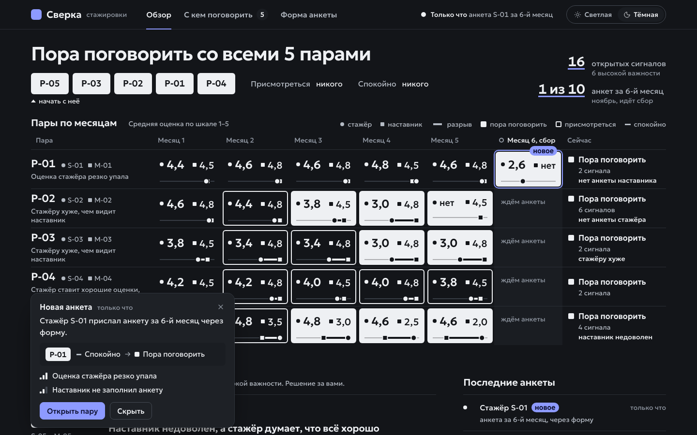

# Дашборд мониторинга стажировок

Решение для кейс-чемпионата МГТС «Код города», направление «ИИ и автоматизация бизнес-процессов».

Стажёр и наставник каждый месяц заполняют анкету: оценки и комментарии. Сейчас HR сопоставляет их вручную. Дашборд собирает ответы в одном месте, показывает динамику и расхождения по каждой паре и подсказывает, с кем пора поговорить и почему.

Статус: рабочий прототип, запускается локально командой `make up`.

## Скриншоты

Обзор: пары по месяцам. В клетке оценки стажёра и наставника и разрыв между ними, заливка значит «пора поговорить».


Пришла анкета стажёра S-01 за 6-й месяц. Дашборд обновился без перезагрузки: P-01 стала «Пора поговорить», слева внизу уведомление с новыми сигналами.



Форма анкеты на телефоне.


Карточка пары, экран «С кем поговорить» и обзор в тёмной теме лежат в `docs/screens/`.

## Как это работает

```
Excel с историей ──► импорт ──┐
                              ├──► база ──► расчёт сигналов ──► дашборд для HR
форма (новый ответ) ──► API ──┘
```

1. История за прошлые месяцы загружается из двух таблиц Excel: ответы стажёров и ответы наставников.
2. Новые ответы приходят из формы, которая повторяет анкету. Ответ по API попадает в сервис, и дашборд обновляется сам.
3. По каждой паре «стажёр — наставник» сервис считает сигналы.
4. HR видит сигналы с объяснением и отмечает, подтвердился сигнал или нет.

## Сигналы

| Сигнал | Как считается | Почему важен |
|---|---|---|
| Спад | оценка падает два месяца подряд или резко за месяц | тренд говорит больше, чем уровень |
| Разрыв | разница между средней оценкой стажёра и наставника за месяц и её рост | одна сторона не видит проблему, которую видит другая |
| Текст против оценки | оценка высокая, а в комментарии жалоба | оценку ставят из вежливости, в тексте пишут правду |
| Молчание | пустой или резко укоротившийся комментарий, пропуск анкеты, одинаковые оценки | кто перестал писать, часто уже не ждёт, что его услышат |
| Наставник недоволен, стажёр доволен | обратный разрыв | стажёр рискует не попасть в штат и не знает об этом |

Правила:

- Оценки считаются формулами. Комментарии разбирает словарь или модель, оценки они не трогают.
- К каждому выводу о тексте прикладывается цитата, и сервис проверяет, что она дословно есть в ответе. Вывод без подтверждённой цитаты отбрасывается.
- ИИ ничего не решает. Он показывает HR, на что посмотреть, решение принимает человек.

## Экраны

Интерфейс один, для HR.

- **Обзор.** Таблица «пара × месяц»: в клетке оценки стажёра и наставника и разрыв, заливка и обводка показывают статус. Ниже очередь «С кем поговорить» и последние анкеты.
- **Карточка пары.** График с двумя линиями (оценки стажёра и наставника), комментарии с подсвеченными цитатами, сигналы с объяснением и рекомендованным действием.
- **Сигналы.** Список «с кем поговорить»: причина, цитата, действие, отметка «Подтвердилось» или «Ложная тревога».
- **Форма.** `/form` для стажёра и наставника, с телефона, без меню дашборда.

## Стек

- **Бэкенд:** Python, FastAPI, SQLite, openpyxl для чтения Excel.
- **Фронтенд:** React, Vite, recharts. Оформление на CSS-переменных, чтобы быстро применить фирменный стиль.
- **Форма:** своя страница `/form` шлёт анкету в `POST /api/ingest`. Яндекс Формы шлют вебхук в `POST /api/ingest/yandex`, ответы Google Форм бэкенд сам забирает из опубликованной таблицы (`POST /api/sync/gsheet`).
- **Разбор текста:** по умолчанию словарь (`LLM_PROVIDER=rules`), работает без сети. С `LLM_PROVIDER=openai` комментарии читает модель через OpenAI-совместимый клиент: Qwen локально через Ollama, чтобы данные не уходили наружу, или внешний API.
- **Запуск:** Docker Compose, локально.

## Данные

Все ответы приводятся к одной схеме:

| Поле | Что в нём |
|---|---|
| `pair_id` | пара «стажёр — наставник» |
| `role` | `intern` или `mentor` |
| `month` | номер месяца программы |
| `question_id` | вопрос анкеты |
| `score` | оценка |
| `text` | комментарий |

Под конкретные таблицы меняется только словарь соответствия колонок.

## Проверка качества

Тестовый набор: несколько пар на шесть месяцев с заложенными сценариями (выгорание, конфликт с наставником, нехватка задач) и благополучные пары для контроля. Проверяем, что сервис находит заложенное, не поднимает тревогу на благополучных и что все цитаты есть в исходных ответах.

## Запуск

Нужны uv, Node 24 с pnpm (`corepack enable`) и Docker (на маке подойдёт colima). Для ссылки на телефон ещё cloudflared.

```sh
make up       # всё в Docker: дашборд http://localhost:8080, форма http://localhost:8080/form
make down     # остановить Docker
make dev      # без Docker: бэкенд :8000, дашборд http://localhost:5173, Ctrl+C гасит оба
make tunnel   # публичная ссылка только на форму (:8081), на телефоне открыть её с /form
make demo     # отправить анкету S-01 за 6-й месяц; для Docker make demo API=http://localhost:8080
```

`cd frontend && pnpm e2e` проходит демо в браузере на http://localhost:8080 после `make up`: обзор, демо-анкета, отметка сигнала, форма с телефона, QR-код. Другой адрес задаёт `BASE_URL`. Сценарий сбрасывает базу к `data/sample`. Браузер для него ставится один раз: `pnpm exec playwright install chromium`.

`make test` гоняет тесты бэкенда и фронта. `make reset` очищает базу и загружает `data/sample` через API, открытые дашборды обновляются сами; для Docker `make reset API=http://localhost:8080`. `make data` пересобирает тестовые наборы.

Анкета лежит в `survey/survey.json`, пороги сигналов в `survey/signals.json`, соответствие колонок Excel в `survey/import_map.json`. Под данные финала правим эти файлы, код не трогаем. Модель для комментариев и Google Формы настраиваются в `.env`, образец в `.env.example`.
